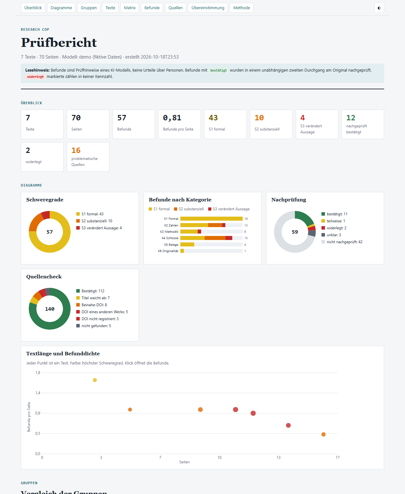

# Research Cop

**Strukturierte, belegte Fehleranalyse wissenschaftlicher Texte mit Claude.**

Research Cop prüft Artikel, Berichte und Abschlussarbeiten nach einem festen Raster auf formale Fehler, Rechenfehler, methodische Mängel, überzogene Schlüsse und fragwürdige Quellen. Jeder Befund hat ein wörtliches Zitat, eine Fundstelle, einen Nachweis und, bei Zahlen, den Rechenweg. Am Ende steht ein interaktives HTML-Dashboard mit Diagrammen und automatisch ausgeschnittenen Belegstellen aus dem PDF.



> Befunde sind Prüfhinweise eines KI-Modells, keine Urteile über Personen. Belastbar sind nur Befunde, die im unabhängigen zweiten Durchgang bestätigt wurden.

## Warum ein Prozess und nicht nur ein Prompt

Ein Sprachmodell, das einen Text einfach noch einmal liest, übersieht genau die Fehler, die plausibel aussehen: eine DOI, die um eine Ziffer verschoben auf den Nachbarartikel zeigt, oder eine Prozentzahl, die zur genannten Basis nicht passt. Research Cop trennt deshalb die Rollen:

| Schritt | Wer | Was |
|---|---|---|
| Einlesen | Python | PDFs, HTML, Text und URLs; Seitentext mit Wortkoordinaten |
| Erstgutachten | Claude | Prüfung nach Raster K1–K6, Schweregrade S1–S3, Nachrechnen in einer Code-Umgebung |
| Zweitgutachten (optional) | Claude, blind | gleicher Auftrag ohne Kenntnis des ersten; Übereinstimmung wird gemessen |
| Nachprüfung | Claude, getrennter Aufruf | jeder substanzielle Befund wird am Original bestätigt, teilweise bestätigt oder widerlegt |
| Quellencheck | Python | jede DOI bei doi.org aufgelöst und mit dem Titel verglichen; Einträge ohne DOI in Crossref gesucht |
| Bericht | Python | Kennzahlen, Diagramme, Belegausschnitte; widerlegte Befunde zählen nicht |

## Prüfraster

| | Kategorie | Beispiele |
|---|---|---|
| K1 | Formal | Zitat ohne Eintrag im Literaturverzeichnis, falsche Jahreszahl |
| K2 | Zahlen & Statistik | Prozentwert passt nicht zur Basis, Text widerspricht Tabelle |
| K3 | Methodik | Stichprobe, Instrument, Reliabilität, Transparenz |
| K4 | Schlüsse | Kausalsprache ohne kausales Design, Abstract ≠ Ergebnisse |
| K5 | Belege | Quelle existiert nicht oder stützt die Aussage nicht |
| K6 | Originalität | Übernahmen ohne Nachweis (nur bei klarem Beleg) |

Schweregrade: **S1** formal · **S2** substanziell · **S3** verändert eine Aussage. Das vollständige Raster steht in [`researchcop/prompts/rubric.md`](researchcop/prompts/rubric.md).

## Installation

Voraussetzung: Python 3.11 oder neuer und ein API-Schlüssel für die Claude-API.

```bash
git clone https://github.com/harubert/research-cop.git
cd research-cop
python -m venv .venv
.venv/Scripts/activate        # Windows; macOS/Linux: source .venv/bin/activate
pip install -e .
export ANTHROPIC_API_KEY=...  # Windows PowerShell: $env:ANTHROPIC_API_KEY="..."
```

Ohne Schlüssel lässt sich das Dashboard mit erfundenen Daten ansehen:

```bash
researchcop demo --open
```

## Benutzung

1. Texte in den Ordner `input/` legen: PDF, HTML, TXT oder Markdown.
2. Optional: URLs zeilenweise in `input/urls.txt` eintragen (PDF oder Webseite).
3. Optional: `input/manifest.csv` mit Gruppen anlegen, um Gruppen zu vergleichen (siehe [`input/README.md`](input/README.md)).
4. Starten:

```bash
researchcop run --open
```

Einzelne Schritte:

```bash
researchcop ingest            # Eingaben einlesen
researchcop review --second   # Erstgutachten (+ blindes Zweitgutachten)
researchcop verify            # substanzielle Befunde nachprüfen
researchcop sources           # Literaturliste extrahieren, DOIs und Crossref prüfen
researchcop report --open     # Dashboard bauen
researchcop status            # Stand je Dokument
```

Fertige Schritte werden nicht wiederholt; `--force` erzwingt eine Wiederholung, `--only <text>` beschränkt auf passende Dokumente. Ergebnisse, Belegbilder und der Bericht liegen in `output/`.

## Konfiguration

`config.example.toml` nach `config.toml` kopieren. Wichtige Einstellungen:

| Schlüssel | Standard | Bedeutung |
|---|---|---|
| `models.review` | `claude-opus-5-5` | Modell für Gutachten |
| `models.effort` | `high` | Gründlichkeit |
| `review.language` | `de` | Sprache der Befunde |
| `review.second_review` | `false` | blindes Zweitgutachten für jeden Text |
| `review.verify_min_severity` | `2` | ab dieser Schwere wird nachgeprüft |
| `review.code_execution` | `true` | Nachrechnen in einer Sandbox |
| `run.workers` | `4` | parallel bearbeitete Dokumente |

Jedes Ergebnis speichert Modell, Datum, Werkzeug- und Rasterversion und den Tokenverbrauch. So bleiben Läufe mit verschiedenen Modellversionen vergleichbar.

## Kosten

Ein Erstgutachten eines zehnseitigen Artikels braucht je nach Dichte grob 50.000–150.000 Tokens. Das Zweitgutachten verdoppelt das, jede Nachprüfung kostet etwa so viel wie ein kurzes Gutachten. Der Tokenverbrauch steht im Bericht unten.

## Grenzen

- Research Cop erkennt nicht, ob ein Text von einer KI geschrieben wurde.
- Quellen hinter Paywalls werden nicht gelesen; geprüft wird, ob sie existieren und zum Titel passen.
- Fehlalarme kommen vor. Deshalb gibt es die Nachprüfung, und deshalb zählen widerlegte Befunde nicht.
- Kennzahlen pro Seite sind nur innerhalb vergleichbarer Textsorten aussagekräftig.

## Datenschutz

- Eingaben und Ergebnisse bleiben lokal in `input/` und `output/`; beide Ordner sind von Git ausgeschlossen.
- An externe Dienste gehen nur: die Texte an die Claude-API, DOIs an doi.org, Titel an Crossref.
- Eine Kontaktadresse wird nur gesendet, wenn sie in `sources.contact_email` eingetragen ist.

## Entwicklung

```bash
pip install -e ".[dev]"
pytest
```

Die Tests laufen ohne API-Schlüssel; die Pipeline wird mit einem simulierten Modell durchgespielt.

---

## English summary

Research Cop runs a structured, evidence-backed error analysis of scientific texts with Claude: a fixed rubric (formal, numbers, method, conclusions, sources, originality; three severity levels), recomputation in a code sandbox, an optional blind second review with measured agreement, independent verification of every substantial finding, a deterministic DOI/Crossref check of the reference list, and an interactive HTML dashboard with evidence crops cut from the PDF. Put files into `input/`, run `researchcop run --open`. Try the dashboard without an API key: `researchcop demo --open`.

## Lizenz

MIT, siehe [LICENSE](LICENSE).
